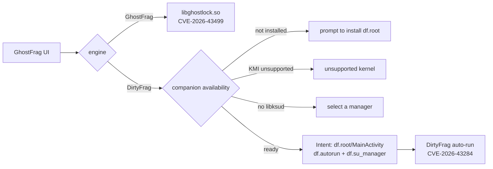

[中文](dirtyfrag-dual-engine-plan_ZH.md) | English

# DirtyFrag companion-APK dual-engine merge plan (2026-11-13)

## Current state and baseline

- The working tree has no `.git` metadata, so no commit can be recorded; the
  baseline date is 2026-11-13.
- GhostFrag: `versionName = 1.2`, `applicationId = com.ghostfrag.app`,
  CVE-2026-43499, profile-driven, Apache-2.0.
- DirtyFrag: `versionName = 1.18` (master), `applicationId = df.root`,
  CVE-2026-43284, GPL-2.0-only.
- Hard constraint: the eight prebuilt LKMs hardcode
  `/data/user_de/0/df.root/bootstrap` (confirmed in
  `dfroot-android14-6.1.ko`); `bootstrap.c` also hardcodes
  `/data/user_de/0/df.root/{bootstrap,ksud,shared_prefs/dfroot.xml}`.
  DirtyFrag therefore cannot be repackaged into the GhostFrag APK unchanged.
- Build environment: no Android SDK/NDK is configured in this workspace, so
  Gradle/NDK builds and on-device verification cannot run here. The commands
  in the verification matrix must be executed on a development machine.

## Goals and constraints

Goals:

1. Bring DirtyFrag sources, LKM assets, and docs into the same repository while
   keeping its GPL-2.0-only license and the separate `df.root` APK.
2. Make GhostFrag the single entry point with an engine selector: GhostFrag
   (CVE-2026-43499) or DirtyFrag (CVE-2026-43284).
3. Detect DirtyFrag availability: companion APK installed, a matching `.ko`
   for the kernel KMI, and `libksud.so` present in the selected SU manager.
4. When DirtyFrag is selected, GhostFrag starts the companion APK with
   auto-run and manager package extras.

Non-goals:

- No changes to `src/core/**`, profile/wire, GLK1, or the route catalog.
- No rebuilding or binary-patching of the eight prebuilt `.ko` files.
- No rewrite of DirtyFrag's Java custom-view UI into Compose.
- No cross-app live log streaming in this plan; DirtyFrag logs stay in the
  companion APK.
- No merge of DirtyFrag's Autorun, Odin Writer, or RO partition protection.

## Architecture decision

Companion APK model:

- The GhostFrag APK does not link DirtyFrag code, avoiding an Apache-2.0 /
  GPL-2.0-only combined work and avoiding LKM path changes.
- DirtyFrag keeps the `df.root` package, signing config, and prebuilt LKMs as
  an optional companion install.
- The two apps cooperate through an explicit `Intent`; DirtyFrag's
  `MainActivity` gains `df.autorun` and `df.su_manager` extras. GhostFrag
  never owns the DirtyFrag process.

## Change list

### Batch 1: repository merge and build

| File | Change | Reason |
|---|---|---|
| `settings.gradle.kts` | `include(":dirtyfrag")` | Keep a separate application module in the same Gradle build |
| `dirtyfrag/build.gradle.kts` | New; keep `applicationId = df.root`, SDK 31/37, arm64, CMake, prebuilt LKMs | Preserve companion identity and native build |
| `dirtyfrag/src/main/AndroidManifest.xml` | Import | Keep DirtyFrag Activity/Receiver declarations |
| `dirtyfrag/src/main/java/df/root/**` | Import | Keep DirtyFrag UI and `ExploitRunner` |
| `dirtyfrag/src/main/jni/**` | Import `exp.c`, `bootstrap.c`, `splicehelper.c`, `aes256.h`, `elf_parser.c`, `libcxx.S`, `include.inc`, `ko_select.h`, `ko/*.ko` | Preserve the original native chain |
| `dirtyfrag/lkm/**` | Import `dfroot.c` and Makefile | Preserve LKM source and rebuild path |
| `dirtyfrag/LICENSE`, `dirtyfrag/NOTICE`, `dirtyfrag/README.md`, `dirtyfrag/CHANGELOG.md` | Import | GPL-2.0-only and provenance |
| `.gitignore` | Ignore `dirtyfrag/src/main/jni/splicehelper`, `dirtyfrag/.cxx`, `dirtyfrag/build` | Keep build outputs out of the tree |

### Batch 2: GhostFrag engine adapter

| File | Change | Reason |
|---|---|---|
| `app/src/main/kotlin/com/ghostfrag/app/domain/model/GhostfragModels.kt` | Add `ExploitEngine` and `DirtyFragAvailability` | Explicit dual-engine state |
| `app/src/main/kotlin/com/ghostfrag/app/data/DirtyFragCompanion.kt` | New: install detection, KMI table, `libksud.so` check, launch Intent | Centralize the companion protocol |
| `app/src/main/kotlin/com/ghostfrag/app/ui/GhostfragUI.kt` | Add engine fields to `GhostfragUiState`; add EngineCard; add actions; make RunButton engine-aware | Single entry point |
| `app/src/main/kotlin/com/ghostfrag/app/ui/GhostfragViewModel.kt` | Engine selection, availability refresh, branch `runExploit()` to DirtyFrag launch | Control-flow split |
| `app/src/main/kotlin/com/ghostfrag/app/ui/MainActivity.kt` | Handle `GhostfragEffect.LaunchDirtyFrag` | Activity owns `startActivity` |
| `app/src/main/AndroidManifest.xml` | `<queries><package android:name="df.root"/></queries>` | Android 11+ package visibility |
| `dirtyfrag/src/main/java/df/root/MainActivity.java` | Extract `startRun()`; read `df.autorun`/`df.su_manager`; auto-run once | Avoid reimplementing DirtyFrag UI in GhostFrag |

### Batch 3: strings, docs, and licensing

| File | Change |
|---|---|
| `app/src/main/res/values/strings.xml`, `values-zh/strings.xml`, `values-pt/strings.xml` | Engine names, unavailable reasons, handoff notice |
| `README.md`, `README_ZH.md` | Companion APK install and dual-engine instructions |
| `docs/development/adding-a-component_ZH.md` | State that a companion app is not a native component and does not enter the component catalog |
| `dirtyfrag/NOTICE` | Record upstream DFRoot, DirtyInit, lspromise, and GPL-2.0-only |

## Data flow / control flow differences

- Before: `onRun()` → validate profile → build GLK1 → launch `libghostlock.so`.
- After: `onRun()` checks `engine` first.
  - `GhostFrag`: unchanged path; DirtyFrag state is not read.
  - `DirtyFrag`: no profile and no GhostFrag `kernelSupported` check; use
    `DirtyFragCompanion.availability()` and emit
    `LaunchDirtyFrag(managerPackage)`, which the Activity turns into a
    `df.root` launch.
- DirtyFrag auto-run: `MainActivity.onCreate()` reads `df.autorun`, writes
  `df.su_manager` into its own `dfroot` SharedPreferences, then calls the
  extracted `startRun()` exactly once (guarded against recreation).
- Invariants:
  - GhostFrag profile, GLK1, native session, and route selection are
    untouched.
  - DirtyFrag LKM, `bootstrap`, and `ExploitRunner` behavior is untouched;
    only entry extras are added.
  - The two engines are mutually exclusive and never run in the same round.

## Compatibility and rollback

- Purely additive: no data migration, no GhostFrag profile storage changes, no
  DirtyFrag preference key changes.
- Rollback: remove the `:dirtyfrag` module, `DirtyFragCompanion`, EngineCard,
  and the `LaunchDirtyFrag` branch; the original GhostFrag path is unaffected.
- The companion APK is optional: when absent, GhostFrag shows "not installed"
  and the GhostFrag engine still works.

## Verification matrix

| Batch | Command/check | Expected |
|---|---|---|
| 1 | `./gradlew :dirtyfrag:assembleDebug` | `df.root` APK with `libdfroot.so`, `libbootstrap.so`, `libdf-d2-launch.so` |
| 1 | `./gradlew :app:assembleDebug` | GhostFrag APK still contains only `libghostlock.so` and `libextract.so` |
| 1 | APK inspection | DirtyFrag `applicationId=df.root`; GhostFrag `com.ghostfrag.app` |
| 2 | `./gradlew :app:testDebugUnitTest` | Existing tests pass; new KMI selection tests pass |
| 2 | Static check | `DirtyFragCompanion` only reads package info; it never touches `/data/user_de/0/df.root` |
| 3 | On-device (hardware required) | Both APKs installed; GhostFrag → DirtyFrag auto-runs; all three unavailable reasons shown correctly |
| 3 | License check | `dirtyfrag/LICENSE` is GPL-2.0-only; GhostFrag `LICENSE` stays Apache-2.0 |

Notes:

- `src/core/**` is untouched, so neither `cmp_disasm` nor the GhostFrag device
  gate is required.
- DirtyFrag results must be archived with DirtyFrag's own log format and must
  not be recorded as a GhostFrag device gate.
- Android SDK/NDK are missing in this workspace; the build commands above
  remain to be executed on a development machine.

## Explicitly preserved

- `src/core/**`, `profile-core/**`, `app/src/main/assets/kernel_profiles/**`.
- DirtyFrag `lkm/**`, `src/main/jni/ko/*.ko`, the `MainActivity` UI, and the
  IPsec/page-cache logic in `ExploitRunner`.
- DirtyFrag's `df.root` package name, version, and signing policy.
- GhostFrag's Shizuku path, CPU-pair selection, and profile import/extractor.

## Progress

- [x] Batch 1: repository merge and build (code complete; Gradle/NDK build
  pending on a development machine)
- [x] Batch 2: GhostFrag engine adapter (code complete; build and on-device
  verification pending)
- [ ] Batch 3: strings, docs, and licensing (three-locale strings and NOTICE
  done; README pending)
