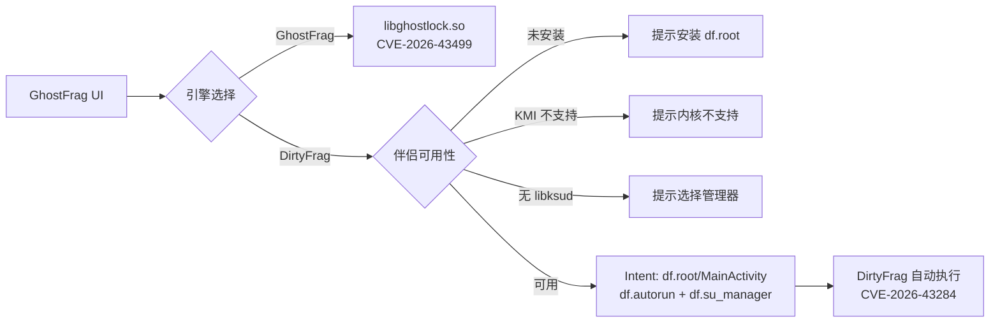

[English](dirtyfrag-dual-engine-plan.md) | 中文

# DirtyFrag 伴侣 APK 双引擎合并计划（2026-11-13）

## 现状与基线

- 工作树没有 `.git` 元数据，无法记录 commit；基线日期为 2026-11-13。
- GhostFrag：`versionName = 1.2`，`applicationId = com.ghostfrag.app`，
  CVE-2026-43499，profile 驱动，Apache-2.0。
- DirtyFrag：`versionName = 1.18`（master），`applicationId = df.root`，
  CVE-2026-43284，GPL-2.0-only。
- 关键约束：8 个预编译 LKM 硬编码 `/data/user_de/0/df.root/bootstrap`
  （已在 `dfroot-android14-6.1.ko` 中确认）；`bootstrap.c` 也硬编码
  `/data/user_de/0/df.root/{bootstrap,ksud,shared_prefs/dfroot.xml}`。
  因此 DirtyFrag 不能直接改包名编入 GhostFrag APK。
- 构建环境：当前工作区未配置 Android SDK/NDK，本轮无法执行 Gradle/NDK
  构建与真机验证；验证矩阵中的命令需要开发机补齐后执行。

## 目标与约束

目标：

1. 在同一仓库引入 DirtyFrag 源码、LKM 资产与文档，保留其 GPL-2.0-only
   许可证和独立 `df.root` APK。
2. GhostFrag 作为唯一入口提供引擎选择：GhostFrag（CVE-2026-43499）或
   DirtyFrag（CVE-2026-43284）。
3. DirtyFrag 可用性检测：伴侣 APK 已安装、内核 KMI 有对应 `.ko`、所选
   SU 管理器的 `libksud.so` 存在。
4. 选择 DirtyFrag 时由 GhostFrag 启动伴侣 APK，并携带自动执行与管理器
   包名参数。

非目标：

- 不改 `src/core/**`、profile/wire、GLK1、route catalog。
- 不重建、不二进制补丁 8 个预编译 `.ko`。
- 不把 DirtyFrag 的 Java 自定义 View UI 重写成 Compose。
- 不在本批次实现跨 App 实时日志回传；DirtyFrag 的日志仍显示在伴侣 APK。
- 不合并 DirtyFrag 的 Autorun、Odin Writer、RO 分区保护等附加功能。

## 架构决策

采用伴侣 APK（companion APK）模型：

- GhostFrag 主 APK 不链接 DirtyFrag 代码，避免 Apache-2.0 与
  GPL-2.0-only 混编，也避免 LKM 路径改写。
- DirtyFrag 保持 `df.root` 包名、签名配置和预编译 LKM，作为可选伴侣安装。
- 两 App 通过显式 `Intent` 协作；DirtyFrag 的 `MainActivity` 增加
  `df.autorun` 与 `df.su_manager` extra，GhostFrag 不直接持有其进程。

## 改动清单

### 批次 1：仓库合并与构建

| 文件 | 改动 | 理由 |
|---|---|---|
| `settings.gradle.kts` | `include(":dirtyfrag")` | 同一 Gradle 工程内保留独立 application 模块 |
| `dirtyfrag/build.gradle.kts` | 新建；沿用 DirtyFrag `applicationId = df.root`、SDK 31/37、arm64、CMake、预编译 LKM | 保持伴侣 APK 身份与 native 构建 |
| `dirtyfrag/src/main/AndroidManifest.xml` | 导入 | 保持 DirtyFrag 的 Activity/Receiver 声明 |
| `dirtyfrag/src/main/java/df/root/**` | 导入 | 保留 DirtyFrag UI 与 `ExploitRunner` |
| `dirtyfrag/src/main/jni/**` | 导入 `exp.c`、`bootstrap.c`、`splicehelper.c`、`aes256.h`、`elf_parser.c`、`libcxx.S`、`include.inc`、`ko_select.h`、`ko/*.ko` | 保留原有 native 链 |
| `dirtyfrag/lkm/**` | 导入 `dfroot.c` 与 Makefile | 保留 LKM 源码与重建依据 |
| `dirtyfrag/LICENSE`、`dirtyfrag/NOTICE`、`dirtyfrag/README.md`、`dirtyfrag/CHANGELOG.md` | 导入 | GPL-2.0-only 与来源说明 |
| `.gitignore` | 忽略 `dirtyfrag/src/main/jni/splicehelper`、`dirtyfrag/.cxx`、`dirtyfrag/build` | 构建产物不入库 |

### 批次 2：GhostFrag 侧引擎适配

| 文件 | 改动 | 理由 |
|---|---|---|
| `app/src/main/kotlin/com/ghostfrag/app/domain/model/GhostfragModels.kt` | 新增 `ExploitEngine` 与 `DirtyFragAvailability` | 显式表达双引擎状态 |
| `app/src/main/kotlin/com/ghostfrag/app/data/DirtyFragCompanion.kt` | 新建：安装检测、KMI 表、`libksud.so` 检查、启动 Intent | 把伴侣协议集中在一个适配器 |
| `app/src/main/kotlin/com/ghostfrag/app/ui/GhostfragUI.kt` | `GhostfragUiState` 增加引擎字段；新增 EngineCard；`GhostfragActions` 增加选择/启动动作；RunButton 按引擎判断可用性 | 单入口选择 |
| `app/src/main/kotlin/com/ghostfrag/app/ui/GhostfragViewModel.kt` | 引擎选择、可用性刷新、`runExploit()` 分支到 DirtyFrag 启动 | 控制流分流 |
| `app/src/main/kotlin/com/ghostfrag/app/ui/MainActivity.kt` | 处理 `GhostfragEffect.LaunchDirtyFrag` | Activity 负责 `startActivity` |
| `app/src/main/AndroidManifest.xml` | `<queries><package android:name="df.root"/></queries>` | Android 11+ 包可见性 |
| `dirtyfrag/src/main/java/df/root/MainActivity.java` | 抽出 `startRun()`；读取 `df.autorun`、`df.su_manager`；自动执行一次 | 免去 GhostFrag 侧重复实现 UI |

### 批次 3：字符串、文档与许可证

| 文件 | 改动 |
|---|---|
| `app/src/main/res/values/strings.xml`、`values-zh/strings.xml`、`values-pt/strings.xml` | 引擎名称、不可用原因、交接提示 |
| `README.md`、`README_ZH.md` | 增加伴侣 APK 安装与双引擎说明 |
| `docs/development/adding-a-component_ZH.md` | 说明“伴侣 App”不是 native component，不进入 component catalog |
| `dirtyfrag/NOTICE` | 记录上游 DFRoot、DirtyInit、lspromise 等来源与 GPL-2.0-only |

## 数据流/控制流差异

- 旧：`onRun()` → 校验 profile → 生成 GLK1 → 启动 `libghostlock.so`。
- 新：`onRun()` 先看 `engine`。
  - `GhostFrag`：保持旧路径，不读 DirtyFrag 状态。
  - `DirtyFrag`：不读 profile、不要求 GhostFrag `kernelSupported`；改用
    `DirtyFragCompanion.availability()` 判定，然后发
    `LaunchDirtyFrag(managerPackage)`，由 Activity 启动 `df.root`。
- DirtyFrag 自动执行：`MainActivity.onCreate()` 读取 `df.autorun`，把
  `df.su_manager` 写入自己的 `dfroot` SharedPreferences，然后调用抽出的
  `startRun()`；只自动执行一次，避免旋转/重建重复触发。
- 不变量：
  - GhostFrag 的 profile、GLK1、native session、route 选择完全不变。
  - DirtyFrag 的 LKM、`bootstrap`、`ExploitRunner` 行为不变，只增加入口参数。
  - 两引擎互斥，不会在同一轮同时运行。

## 兼容性与回滚

- 纯增量：不迁移数据、不改 GhostFrag profile 存储、不改 DirtyFrag prefs 键。
- 回滚：删除 `:dirtyfrag` module、`DirtyFragCompanion`、EngineCard 与
  `LaunchDirtyFrag` 分支即可；GhostFrag 原有路径不受影响。
- 伴侣 APK 可选：未安装时 GhostFrag 只显示“未安装”，不影响 GhostFrag 引擎。

## 验证矩阵

| 批次 | 命令/检查 | 预期 |
|---|---|---|
| 1 | `./gradlew :dirtyfrag:assembleDebug` | 产出 `df.root` APK，含 `libdfroot.so`、`libbootstrap.so`、`libdf-d2-launch.so` |
| 1 | `./gradlew :app:assembleDebug` | GhostFrag APK 仍只含 `libghostlock.so`、`libextract.so` |
| 1 | APK 检查 | DirtyFrag APK `applicationId=df.root`；GhostFrag APK `com.ghostfrag.app` |
| 2 | `./gradlew :app:testDebugUnitTest` | 既有测试全过；新增 KMI 判定单测 |
| 2 | 静态检查 | `DirtyFragCompanion` 只读包信息，不访问 `/data/user_de/0/df.root` |
| 3 | 真机（需设备） | 安装两 APK；GhostFrag 选择 DirtyFrag → 伴侣自动执行；未安装/KMI 不支持/无 libksud 三种提示正确 |
| 3 | 许可证检查 | `dirtyfrag/LICENSE` 为 GPL-2.0-only；GhostFrag `LICENSE` 保持 Apache-2.0 |

说明：

- 本批次不触及 `src/core/**`，因此不要求 `cmp_disasm` 与 GhostFrag 真机门禁。
- DirtyFrag 的真机结果需要按 DirtyFrag 自己的日志格式单独归档，不能记作
  GhostFrag 门禁。
- 当前环境缺 Android SDK/NDK，上述构建命令待开发机补齐后执行。

## 明确保留

- `src/core/**`、`profile-core/**`、`app/src/main/assets/kernel_profiles/**`：
  不改。
- DirtyFrag 的 `lkm/**`、`src/main/jni/ko/*.ko`、`MainActivity` 主体 UI、
  `ExploitRunner` 的 IPsec/页缓存逻辑：不改。
- DirtyFrag 的 `df.root` 包名、版本号、签名策略：不改。
- GhostFrag 的 Shizuku 路径、CPU 对选择、profile 导入/提取：不改。

## 进度

- [x] 批次 1：仓库合并与构建（代码完成；Gradle/NDK 构建待开发机验证）
- [x] 批次 2：GhostFrag 侧引擎适配（代码完成；构建与真机验证待开发机）
- [ ] 批次 3：字符串、文档与许可证（三语言字符串与 NOTICE 已完成，README 待补）
